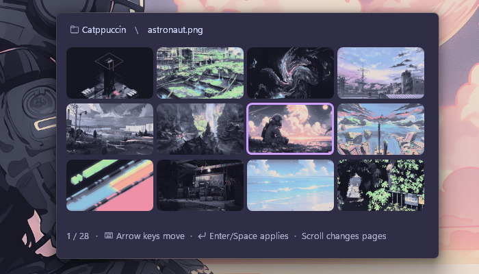
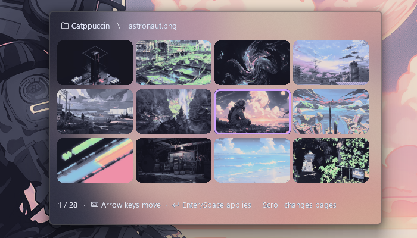
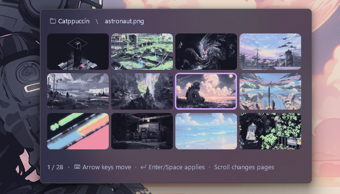
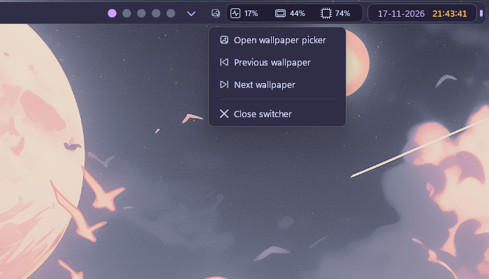

# Simple Wallpaper Switcher

## Screenshots
| Solid | Blurred |
|:---:|:---:|
|  |  |

| Acrylic | Quick-menu |
|:---:|:---:|
|  |  |

### Your wallpaper collection, ready when you are.

Browse your wallpapers in a compact visual picker, choose a new look, and watch it transition onto your desktop.

## Find your next wallpaper

See your collection as a grid of thumbnails. Browse folders with the breadcrumb menu, click a wallpaper to apply it, or use the keyboard to move through your collection.

## Stay in the flow

Choose another wallpaper while a transition is running. The effect retargets to your latest choice, so you can keep browsing without waiting for each change to finish.

## Make it yours

Choose from the shared Emberveil themes and set the picker background to Solid, Blur, or Acrylic. Pick a transition effect, or let Random choose one for you.

## Get started

Set your wallpaper folder in the mod settings, then open the picker from its tray icon or keyboard shortcut.

Click a thumbnail to apply it. Use the arrow keys to move, Enter or Space to apply, and the mouse wheel to change pages. Click the magnifying glass in the breadcrumb, or start typing, to filter filenames in the current folder. Press Escape to clear the search.

Supported image formats: JPEG, PNG, BMP, and WebP.

## License

Licensed under the MIT License. See [LICENSE](LICENSE).
